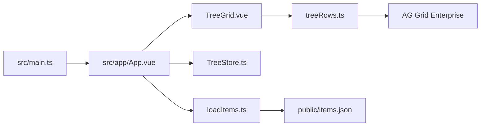
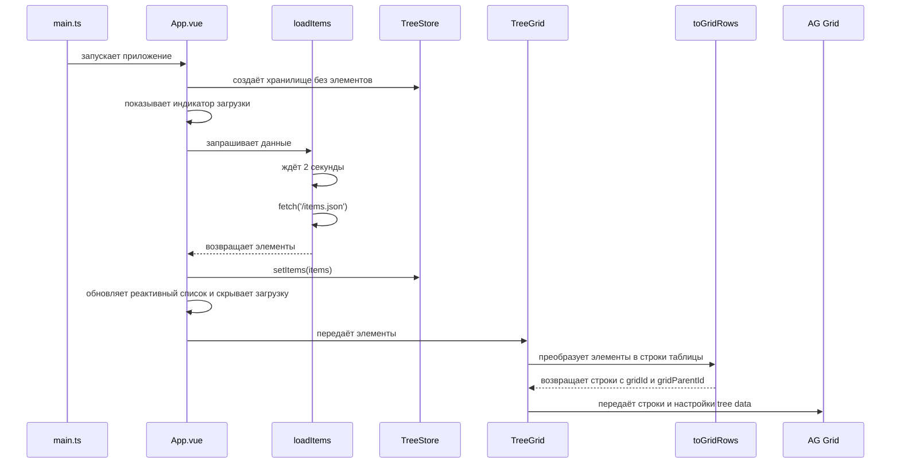

# Описание реализации

Проект показывает плоский список элементов как дерево в таблице. Приложение написано на Vue 3 и TypeScript; таблицу предоставляет AG Grid Enterprise.

## Структура

- `src/main.ts` регистрирует модули AG Grid, подключает общие стили и запускает приложение.
- `src/app/App.vue` управляет загрузкой, создаёт пустой `TreeStore` и передаёт данные таблице.
- `src/features/tree/TreeStore.ts` хранит элементы и предоставляет методы чтения и изменения дерева.
- `src/features/tree/loadItems.ts` ждёт две секунды и получает `public/items.json` через `fetch`.
- `src/features/tree/treeRows.ts` добавляет к элементам поля, необходимые AG Grid для дерева и отображения категории.
- `src/features/tree/TreeGrid.vue` настраивает столбцы и древовидное отображение строк.



## Поток данных



## Хранилище дерева

Входные элементы остаются в плоском массиве. `TreeStore` строит индексы в один проход, поэтому исходный порядок элементов не зависит от порядка или значения их ID.

| Структура      | Назначение                                             |
| -------------- | ------------------------------------------------------ |
| `items`        | Полный список в исходном порядке                       |
| `itemsById`    | Поиск элемента по ID                                   |
| `indexById`    | Поиск позиции элемента для обновления и переиндексации |
| `parentById`   | Переход от элемента к родителю                         |
| `childrenById` | Получение непосредственных дочерних элементов          |

`getAllChildren` выполняет итеративный обход в глубину и возвращает потомков в порядке обхода. `getAllParents` строит путь от элемента к корню. Оба метода обходят дерево без рекурсивных вызовов; обход потомков также защищён от повторного посещения ID.

При добавлении или смене родителя хранилище проверяет, не создаст ли связь цикл. `removeItem` находит узел и его потомков, удаляет их и обновляет индексы оставшихся элементов.

## Строки таблицы

`toGridRows` сохраняет исходные поля и добавляет:

- `gridId` — строковый ID для AG Grid. Префикс типа (`number:` или `string:`) различает, например, числовой `1` и строковый `'1'`.
- `gridParentId` — закодированный ID родителя; у корневого узла равен `null`.
- `category` — `Группа`, если ID элемента встречается как родитель, иначе `Элемент`.

Tree data в AG Grid строит связи по `gridParentId`. Колонка категории отображает групповой renderer с раскрытием узлов, а колонка `№ п/п` использует текущую позицию строки в таблице.

## Проверки

```sh
npm test
npm run build
```

Тесты `TreeStore` находятся рядом с классом и проверяют операции над деревом, смешанные типы ID, порядок обхода и глубокие деревья. `treeRows.test.ts` проверяет адаптацию строк и различение ID. `App.test.ts` проверяет задержку загрузки и переход от состояния загрузки к таблице.
